  

# 🌐 Awesome Cloud Network & DNS Infrastructure 🚀

  
  
  
  
  
  
  

> ⚡ **A curated directory of premier SaaS platforms and battle-tested open-source projects for Cloud Networking, Authoritative DNS, Anycast Global Traffic Steering (GSLB), and Edge Infrastructure.**

---

## 📑 Table of Contents
- [📌 Sector Overview & Market Dynamics](#-sector-overview--market-dynamics)
- [☁️ SaaS / Hosted Cloud DNS Platforms](#️-saas--hosted-cloud-dns-platforms)
- [💻 Open-Source GitHub Projects](#-open-source-github-projects)
- [🛠️ Architectural Design Stacks](#️-architectural-design-stacks)
- [🤝 How to Contribute](#-how-to-contribute)
- [💖 Support](#-support)
- [📊 Star History](#-star-history)
- [⚠️ Disclaimer](#️-disclaimer)

---

## 📌 Sector Overview & Market Dynamics

The global **Managed DNS and Cloud Network Infrastructure** market is valued at approximately **$2.1 billion in 2026** (expanding within a broader **$16+ billion** enterprise DDI market) and growing at a compound annual growth rate of ~18–22% driven by distributed edge compute, Anycast routing, automated GitOps workflows, and Zero Trust security mandates. 

The sector exhibits **moderate concentration / oligopolistic tendencies** at the hyperscale edge—dominated by mega-cap cloud providers (**Microsoft Azure**, **Alphabet Google Cloud**, **Amazon Web Services**) and specialized edge/CDN titans (**Cloudflare**, **Akamai**)—while preserving a rich, thriving ecosystem of **fragmented open-source control planes**, privacy resolvers, and hybrid on-premises DDI appliances.

---

## ☁️ SaaS / Hosted Cloud DNS Platforms

| 🏢 Product | 📈 Company Size (Valuation / Market Cap) | 📝 Description | 💳 Pricing (Starting) | 🎁 Free Tier / Trial Limits |
|:---|:---|:---|:---|:---|
| **[Azure DNS](https://azure.microsoft.com/en-us/products/dns/)** | ~$4.04 Trillion *(Microsoft Market Cap)* | Public and private DNS zone hosting with native Azure Resource Manager integration, alias records, and Traffic Manager. | $0.50/hosted zone/mo (first 25 zones); $0.40/million queries (first 1B) | **Free trial**: 30-day free trial with $200 credit applicable to Azure DNS zones and queries (no permanent free tier) |
| **[Google Cloud DNS](https://cloud.google.com/dns)** | ~$3.54 Trillion *(Alphabet Market Cap)* | Global Anycast authoritative DNS with 100% SLA, private zones, DNS forwarding, and automated DNSSEC. | $0.20/managed zone/mo (first 25 zones); $0.40/million queries (first 1B) | **Free trial**: 90-day free trial with $300 cloud credits usable across GCP services (no permanent free tier for Cloud DNS) |
| **[AWS Route 53](https://aws.amazon.com/route53/)** | ~$2.89 Trillion *(Amazon Market Cap)* | Highly available authoritative DNS with health checks, latency routing, geolocation, and automatic failover. | $0.50/hosted zone/mo (first 25 zones); $0.40/million queries (first 1B) | **Free trial & resource limits**: No free hosted zones; free alias queries mapped to AWS resources (CloudFront/ALB), up to 1,000 CIDR blocks/mo & 50 AWS endpoint health checks |
| **[Oracle Dyn (OCI DNS)](https://www.oracle.com/cloud/networking/dns/)** | ~$350 Billion *(Oracle Market Cap)* | Enterprise managed DNS and traffic steering natively hosted on Oracle Cloud Infrastructure global anycast network. | $0.85/million queries (no base monthly zone fee) | **Free forever**: Oracle Cloud Always Free includes up to 5 public DNS zones with 25,000 records per zone |
| **[NS1 Connect (IBM)](https://www.ibm.com/products/ns1-connect)** | ~$230 Billion *(IBM Market Cap)* | Developer & DevOps-centric enterprise DNS with advanced traffic steering filter chains, real-time telemetry, and API-first design. | Essentials plan starts at $99/mo (includes up to 30M queries and 1,000 records) | **Free forever & 30-day trial**: 30-day free enterprise trial (50M queries, 500 records); defaults to Free Developer Tier forever (5M queries/mo, 500 records, 1 filter chain, 2 monitors) |
| **[Cloudflare](https://www.cloudflare.com/)** | ~$100 Billion *(Cloudflare Market Cap)* | Global edge network with authoritative Anycast DNS, multi-Tbps DDoS protection, CDN, and Workers serverless compute. | Free: $0/mo; Pro: $25/mo; Business: $200/mo | **Free forever**: unmetered DDoS mitigation, authoritative DNS, global CDN, 100k Workers requests/day |
| **[Zoho Domains](https://www.zoho.com/domains/)** | ~$13.5 Billion *(Zoho Valuation)* | Transparent domain registration and integrated DNS hosting with zero hidden renewal markups and free privacy shield. | Free DNS hosting with registered domain (domains start at $11.99/year for .com with free WHOIS privacy) | **Free forever**: Complete DNS zone management (A, CNAME, MX, TXT, SRV records) included free indefinitely with any domain |
| **[Akamai Edge DNS](https://www.akamai.com/products/edge-dns)** | ~$12.5 Billion *(Akamai Market Cap)* | Highly resilient Anycast DNS built on the distributed Akamai platform with zone-based pricing and DDoS absorption. | Zone-based flat annual/monthly pricing (query-independent fixed fee structure) | **Free trial**: Enterprise trial evaluation available upon request through sales & Akamai Control Center Marketplace |
| **[Neustar UltraDNS (Vercara / DigiCert)](https://vercara.com/ultradns)** | ~$8.0+ Billion *(DigiCert Valuation)* | Carrier-grade authoritative DNS with 100% uptime SLA, global traffic management, and multi-Tbps DDoS mitigation. | Starts at ~$49/mo (standard self-serve baseline); custom enterprise contracts | **Free trial**: 30-day guided enterprise proof-of-concept / evaluation via DigiCert/Vercara sales |
| **[Fastly](https://www.fastly.com/)** | ~$3.0 Billion *(Fastly Market Cap)* | High-performance secondary DNS integrated into Fastly's programmable edge cloud and modern CDN architecture. | Secondary DNS billed per 1M responses (requires active delivery contract) | **Free trial / recurring credit**: Recurring $50 monthly developer usage credit to test edge delivery and compute resources |

---

## 💻 Open-Source GitHub Projects

Curated collection of the most trusted open-source DNS resolvers, authoritative nameservers, and GitOps DNS orchestration engines:

| 📦 Project | ⭐ Stars_Badge | 📝 Description |
|:---|:---|:---|
| **[Pi-hole](https://github.com/pi-hole/pi-hole)** |  | Network-wide ad blocking and private sinkhole DNS server providing local caching, DHCP, and privacy-focused DNS control. |
| **[AdGuard Home](https://github.com/AdguardTeam/AdGuardHome)** |  | Network-wide ads, trackers, and malware-blocking DNS server with native support for DNS-over-HTTPS (DoH), DNS-over-TLS (DoT), and DNS-over-QUIC (DoQ). |
| **[CoreDNS](https://github.com/coredns/coredns)** |  | Cloud-native DNS server (CNCF graduated) designed for Kubernetes service discovery with a fast, plugin-based architecture. |
| **[miekg/dns](https://github.com/miekg/dns)** |  | High-performance, idiomatic Go DNS library used as the foundational engine behind CoreDNS, Kubernetes DNS, and microservice discovery frameworks. |
| **[Unbound](https://github.com/NLnetLabs/unbound)** |  | High-performance validating, recursive, and caching DNS resolver with built-in DNSSEC and DNS-over-TLS support. |
| **[PowerDNS](https://github.com/PowerDNS/pdns)** |  | Robust authoritative DNS server with flexible database backends (SQL, LDAP), automated DNSSEC signing, and dnsdist load balancer. |
| **[DNSControl](https://github.com/StackExchange/dnscontrol)** |  | Infrastructure-as-code (IaC) system for managing DNS zones across dozens of DNS service providers and BIND zonefiles simultaneously. |
| **[octoDNS](https://github.com/octodns/octodns)** |  | GitOps-driven multi-provider DNS configuration management and synchronization tool for configuring multi-cloud and redundant DNS setups. |
| **[BIND 9](https://github.com/isc-projects/bind9)** |  | The reference implementation of authoritative and recursive DNS. Supports DNSSEC, TSIG, views, and zone transfers. |
| **[NSD](https://github.com/NLnetLabs/nsd)** |  | High-speed, authoritative-only RFC-compliant DNS name server designed for root servers and top-level domain registries. |
| **[Knot Resolver](https://github.com/CZ-NIC/knot-resolver)** |  | Modular, extensible caching full DNS resolver implementing modern RFC standards, DNS-over-TLS, and Lua scripting. |
| **[Knot DNS](https://github.com/CZ-NIC/knot)** |  | High-performance authoritative-only DNS server with automated DNSSEC signing, on-the-fly zone updates, and geographic balancing. |

---

## 🛠️ Architectural Design Stacks

Building a production-ready, vendor-neutral DNS infrastructure stack:
- **Authoritative Nameservers:** Combine **PowerDNS** or **BIND 9** for resilient zone hosting and automated DNSSEC signing.
- **Recursive & Validating Layer:** Deploy **Unbound** or **Knot Resolver** for ultra-low-latency local caching, upstream forwarders, and DNS-over-TLS validation.
- **Microservices & Cloud-Native:** Leverage **CoreDNS** natively inside Kubernetes clusters for dynamic endpoint discovery.
- **GitOps & Multi-Cloud Redundancy:** Use **DNSControl** or **octoDNS** to maintain DNS zones as code in Git, pushing synchronized record updates across multi-cloud and hybrid environments without vendor lock-in.

---

## 🤝 How to Contribute

Contributions are welcome and appreciated! Follow these steps to submit additions:
1. 🍴 **Fork** the repository.
2. 🌿 Create a feature branch (`git checkout -b feature/new-dns-resource`).
3. 📝 Add or edit entries in `README.md` keeping descriptions factual, concise, and linked to official repositories or homepages.
4. 🚀 Submit a **Pull Request** with a brief summary of the proposed changes.

---

## 💖 Support

If you find this repository helpful for your network architecture or cloud infrastructure research:
- ⭐ **Star** this repository on GitHub!
- 🍴 **Fork** and share it with fellow SREs, network engineers, and DevOps architects.
- ☕ Consider buying a coffee and supporting ongoing maintenance via the [GitHub Sponsors Dashboard](https://github.com/sponsors/ishandutta2007)!

---

## 📊 Star History

---

## ⚠️ Disclaimer

- This is a **community-curated list** provided for educational and architectural reference—not an official commercial endorsement.
- DNS infrastructure represents a vital security perimeter: always enforce DNSSEC validation where possible, restrict zone transfers (`AXFR`/`IXFR`) strictly to authenticated secondaries, and actively monitor against DNS hijacking and cache poisoning attacks.
- High-availability DNS architectures require geographic Anycast clustering or distributed multi-region failover.

---

  Made with ❤️ for network engineers, SREs, platform architects, and developers building the resilient internet.

